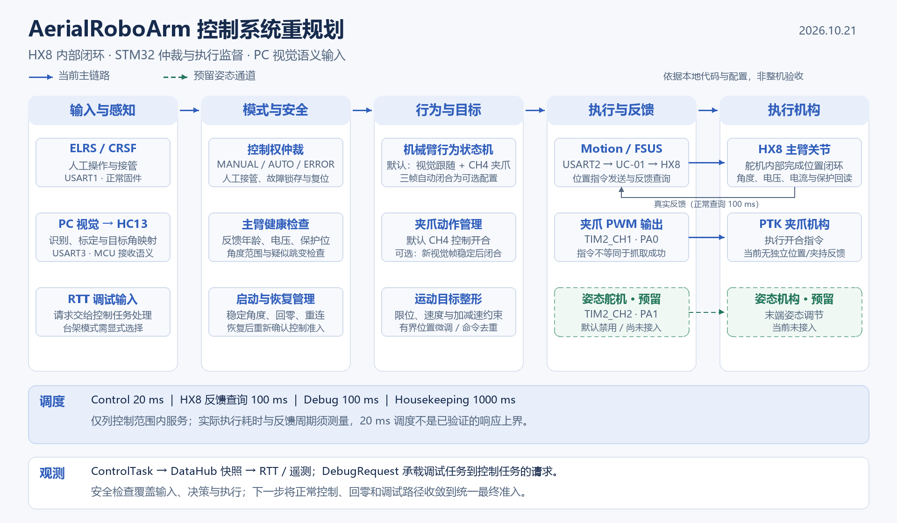
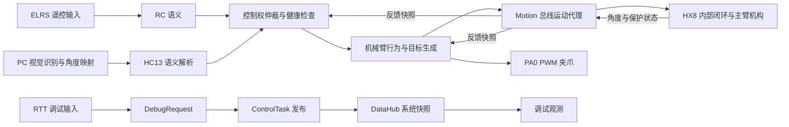

# AerialRoboArm 控制系统重规划

日期：2026-10-21。依据：本地工作区的正常固件入口、任务实现、编译开关及现有硬件记录。本文范围为遥控、视觉输入、主臂、夹爪及其调度与安全管理，不作为仓库全部功能或线程的清单，也不等同于已烧录版本或整机实测验收报告。

## 1. 新版系统定位

当前系统应定义为：**以 STM32 为机载决策节点、以 HX8 内部闭环舵机为主臂执行器、以 PC 视觉提供目标语义、支持人工接管的单轴机械臂控制系统。**

设计重点由“主控运行电机位置控制与 FOC”转向“控制权仲裁、运动目标生成、总线执行、反馈监督与抓取时序”。无人机飞控不属于本机械臂控制器的职责。

本文作为当前架构入口；`00_SYSTEM_CONSTITUTION.md` 与 `01_RUNTIME_ARCHITECTURE.md` 已标记为旧 BLDC/AS5600 方案，保留用于历史追溯。

## 2. 与旧图的对应关系

| 旧图内容 | 当前事实 | 新版规划 |
| --- | --- | --- |
| 关节无刷电机、独立 AS5600 | 主臂改为 HX8-U26H-M，经 UC-01 接入 USART2；旧 AS5600 路径未启用 | 画为“总线位置执行器”，角度和保护状态由 HX8 回读 |
| PID + FOC、三相 PWM/使能 | 正常主臂路径已不使用；位置闭环在舵机内部完成 | MCU 侧画目标角、速度、加减速、命令去重及有界位置微调 |
| 主控视觉处理任务 | MCU 解析 HC13 语义；图像识别与几何映射属于 PC/伴随计算侧 | 将“视觉算法”和“视觉消息接入”分开画 |
| 机械臂决策任务 | 已拆为 TaskArbiter 与 TaskManipulator，外加 app_control 的启动及恢复管理 | 保留仲裁、行为、运动代理三种职责 |
| 1 ms 高频控制 + 20 ms 决策 | 控制主链路为 20 ms ControlTask，调试与看门狗由独立任务承载 | 画控制范围内的真实运行周期，不再保留 MCU 1 kHz FOC 环 |
| DataHub 共享数据中心 | 当前为 ControlTask 单写、多读的系统观测快照；调试请求另走 DebugRequest | 放到观测侧，不承担任意模块共享和控制权仲裁 |
| 夹爪与姿态舵机 | PA0 夹爪启用；PA1 姿态通道默认禁用 | 姿态执行器标为预留，不列为已验证功能 |

## 3. 建议采用的总图

[SVG 矢量版](../../Figures/architecture/control_system_replan_20261021.svg)。图中虚线表示预留的姿态执行器通道。

正常固件当前主链路如下。图中的反馈同时供健康检查、动作判断及有界位置微调使用，不代表 MCU 重新实现舵机内部位置环。

上图省略启动、回零和专用调试分支的内部细节。当前调试请求可选择专用控制路径；“所有来源统一经过最终安全门”属于后文的重构目标。

## 4. 分层职责与控制边界

| 层/域 | 内容 | 边界 |
| --- | --- | --- |
| 外部感知域 | PC 图像采集、检测、跟踪、标定、目标角映射；后续短时预测 | 不直接访问 MCU 执行器，不把 PC 的可抓取判断当作最终执行授权 |
| 输入接入层 | ELRS/CRSF、HC13 视觉语义、RTT 调试请求 | 输出带有效性、时效和来源的数据 |
| 仲裁与安全层 | 模式、人工接管、故障锁存、反馈健康、启动及重连准入 | 决定谁能发动作、是否允许动作及退出条件 |
| 行为与目标层 | MANUAL/AUTO 行为、回零、夹爪时序、限速和目标整形 | 生成统一命令；不包含串口收发等待 |
| 执行服务层 | TaskMotion/FSUS、mod_actuator/PWM、设备驱动和 BSP | 负责事务、反馈、限幅和命令执行 |
| 调度与观测侧 | FreeRTOS、DataHub、DebugRequest、RTT、看门狗 | 作为横跨各层的基础设施，不混为一个业务任务层 |

代码仍可沿用 `app / task / mod / drv / bsp` 目录。功能框不必一一对应 RTOS 线程：RC、仲裁、行为和 Motion 当前都由同一 ControlTask 调用。

HX8 内部位置闭环与 MCU 外部监督是两个不同边界。当前 `mod_position_trim` 已实现反馈稳定后的有限位置修正，默认启用、总修正量限制为 ±1.5°；新版图应保留这项能力，同时避免描述成高频 PID/FOC。

## 5. 运行时与时序规划

| 容器/服务 | 当前配置 | 规划要求 |
| --- | --- | --- |
| ControlTask | 20 ms，优先级 AboveNormal | 保留为输入、仲裁、行为及执行协调主线程 |
| HX8 目标发送 | 最小更新间隔 40 ms；目标变化检测；静态目标低频刷新 1000 ms | 避免每个控制周期重发而反复重启舵机轨迹 |
| HX8 ServoMonitor | 100 ms 查询周期 | 用真实新反馈判断到位和保护；不能把 50 Hz 控制快照当作 50 Hz 编码器采样 |
| DebugTask | 100 ms，Low | 负责控制台、日志及遥测；动作请求交回控制任务 |
| Housekeeping | 1000 ms，Normal | 依据控制心跳刷新 IWDG；心跳新鲜窗口配置 3000 ms |

**20 ms 是当前调度目标，尚不能宣称为经验证的最坏响应上界。** 目前 FSUS 发送为阻塞方式，回包等待通过 `osDelay(1)` 让出 CPU，单次接收超时配置 20 ms；叠加发送、总线间隔和多个事务后可能超过一拍。

先增加控制循环耗时、超期次数、事务耗时、真实反馈间隔的观测。若实测无法满足控制和接管需求，再将 Motion 收发改为可分步推进的事务状态机；需要时再独立 IO 线程，避免在尚未测量前堆叠任务。

如需提高回读频率，先检查协议、总线占用和舵机承受能力，再同步调整反馈过期判据，不能只改查询周期。

## 6. 模式与安全策略

当前正常模式包括 INIT、IDLE、MANUAL、AUTO、ERROR；启动阶段另有 BOOT、PING、CONFIG、ENABLE、RUNNING、FAULT，不应混为同一组状态。

| 场景 | 当前行为/事实 | 下一步要求 |
| --- | --- | --- |
| MANUAL | CH1 增量目标控制主臂；RC 控制末端 | 保持直接接管，模式切换从当前有效角度重新接续目标 |
| 默认 AUTO | 主臂持续跟随新鲜视觉目标；进入时夹爪张开，之后由 CH4 接管 | 作为当前监督式演示基线，不称为全自动抓取 |
| 可选三帧方案 | `AUTO_GRIP_THREE_FRAME=ON` 才启用；新视觉帧计数触发闭合，闭合后主臂仍跟随 | 独立保留为验证配置，不与默认方案混述 |
| 视觉过期 | 默认 200 ms 失效；置信度门限 60%；不再采用新目标，保留上一个主臂目标 | 明确它可能继续完成此前轨迹，不等同于立即停止在当前角度 |
| 急停、RC 失联、堵转 | 正常仲裁进入 ERROR，相关故障锁存；原因清除后还需复位脉冲 | 保留两步恢复，禁止故障清除后直接续跑旧自动动作 |
| 主臂反馈异常 | 检查反馈年龄、角度、电压、保护位及疑似编码器跳变；启动/恢复使用稳定反馈门 | 将这些条件收敛成可观测的统一健康判定 |
| 重连与回零 | 已有稳定角度检查、默认零位动作、回中保护及回零超时 | 图中保留启动与恢复管理；具体动作准入沿用专门状态机 |
| RTT/VOFA 调试 | 存在强制角度、夹爪覆盖和无需 ELRS 的台架模式 | 显式记录命令所有者、退出及复位条件，统一最终执行门 |

建议控制权次序为：**最终安全门 → 已明确选择的控制来源 → 行为生成**。正常运行以人工接管优先于 AUTO；台架调试作为显式选择的另一运行场景，不应通过伪造“遥控在线”来模糊来源。

建议将当前分散在 app_control、仲裁和 Motion 的最终准入收敛为统一检查点，让正常 AUTO、MANUAL、回零及调试命令都受到一致的机构限位与反馈健康约束。此项是重构建议，本文没有更改其实现。

必须分别定义“保持当前位置”“保持上一目标”“停止并释放力矩”“夹爪保持”四种动作。当前正常主臂 `torque_on=false` 对应 Stop/unlock，不能把它描述为“保持当前位置”。载荷条件下采用哪种动作，应结合机构验证。

看门狗复位不能保证舵机同步停止，UART 断线也不能保证停止帧到达。若后续需要独立于通信的停机能力，应单列硬件使能/供电控制设计及验证，不能把它标为本版已有功能。

## 7. 视觉跟随与夹爪动作规划

**默认方案保持“视觉控制主臂跟随、CH4 控制夹爪”**。进入 AUTO 时先张开夹爪，待 CH4 操作后由人工控制；退出 AUTO 或人工接管时，清理自动动作状态，避免旧动作在下一次进入时继续执行。

三帧自动闭合仍作为显式开启的可选配置：仅累计进入 AUTO 后收到的新有效视觉观察，满足稳定条件才下发闭合指令。闭合后继续主臂跟随，不把夹爪闭合当作主臂停止条件。无目标、视觉过期、主臂故障或调试覆盖时，未完成的稳定帧计数应按既有策略重置。

视觉稳定只说明观测连续性；PWM 输出只说明闭爪命令已发出，均不能单独证明抓取成功。结果验证采用录像与实物留存判据，记录每次命令、目标、反馈和人工操作。

动态目标路线先完成受控台架的几何标定与端到端延迟测量，再推进一维短时预测。目标沿基座 Z 轴运动是一项实验约束，不表示机械臂可以独立控制 X、Z 两轴。`04_Z_AXIS_TRAJECTORY_FEASIBILITY_PLAN.md` 中的历史检测指标和可行性判断需重新验证后再沿用。

## 8. 数据与接口契约

| 契约 | 当前用途 | 建议补充 |
| --- | --- | --- |
| RcControlData | 遥控模式、接管、目标及夹爪语义 | 将真实遥控状态与台架来源授权分开表达 |
| VisionIntent | 角度、速度、置信度、稳定帧、MCU 接收帧计数及接收时刻 | 后续协议增加源序号、目标标识、有效期；预测模式增加约定清楚的预测时刻 |
| MotionCmd | 角度、速度、加减速时间、功率、力矩请求 | 区分逻辑目标和微调后的总线目标；记录来源/命令序号 |
| MotionState | 新鲜/缓存反馈、反馈年龄、总线结果、保护与微调状态 | 到位及故障逻辑只消费真实新反馈，记录反馈采样边界 |
| DataHub | 控制任务发布系统观测，调试任务读取 | 增加命令所有者、动作准入原因、循环超期计数；继续保持单写 |
| DebugRequest | 调试任务到控制任务的单槽请求 | 对停止/复位等关键请求增加不被普通命令覆盖的机制及处理确认 |

当前视觉链路兼容 `V,<angle>,<speed>,<confidence>[,<stable_frames>]`；ACK 表示解析收到，不能当作执行到位。MCU 本地帧计数不是相机源序号，MCU 接收时刻也不是相机曝光时刻，现有“200 ms 新鲜”无法排除上游已缓存很久的图像结果。

不要直接以 PC 时间减 MCU 时间来计算目标年龄。第一阶段使用 MCU 接收时效配合实测端到端延迟；需要按相机曝光时间执行预测时，再设计时钟映射及其误差界。

## 9. 实施顺序与验收

| 阶段 | 交付 | 验收依据 |
| --- | --- | --- |
| P0 固化当前基线 | 保存控制固件参数、配置和版本；补齐控制耗时观测 | 可区分默认手动夹爪与可选三帧夹爪；实测循环耗时与反馈周期 |
| P1 统一执行准入 | 显式控制来源、停止语义、故障恢复、关键调试请求确认 | 覆盖正常/调试/回零路径；失联、保护、急停、重连及模式切换无旧目标意外恢复 |
| P2 标定执行器 | 角度映射、负载、速度/加减速、到位延迟和位置微调数据 | 区分命令速度与实测速度；形成可重复实验记录，按数据修正运动包络 |
| P3 验证视觉与夹爪协同 | 默认 CH4 控制流程、可选三帧闭合、模式切换及原因码 | 旧帧/重复帧不累计；无效视觉不触发新自动闭合；人工可随时接管 |
| P4 受约束动态抓取 | 标定、时间契约、短时预测及低速实抓验证 | 独立真值评估预测误差、端到端延迟和重复抓取结果，明确成功判据 |

各阶段应保存独立验证记录。默认演示仍表述为“视觉辅助、人工监督的机械臂控制系统”；只有完成对应配置的真实抓取验证后，才声明其自动抓取能力。

## 10. 当前事实来源

- 正常入口及构建隔离：`Core/Src/main.c`、`Core/Src/freertos.c`、`CMakeLists.txt`。
- 线程周期与优先级：`User/global/Inc/ara_prio.h`。
- 启动、恢复、调试和安全组织：`User/app/Src/app_control.c`。
- 仲裁、默认 AUTO 与可选三帧方案：`User/task/Src/task_arbiter.c`、`User/task/Src/task_manipulator.c`、[AUTO_PICK_SEQUENCE](../hardware/AUTO_PICK_SEQUENCE.md)。
- 总线执行、反馈及微调：`User/task/Inc/task_motion.h`、`User/task/Src/task_motion.c`、`User/mod/Inc/mod_position_trim.h`。
- 数据交换：`User/global/Inc/datahub.h`、`User/global/src/debug_request.c`。
- 接线与禁用通道：[pinmap](../hardware/pinmap.md)。

本文及配图只更新规划材料，没有更改固件、构建开关或板上程序。
