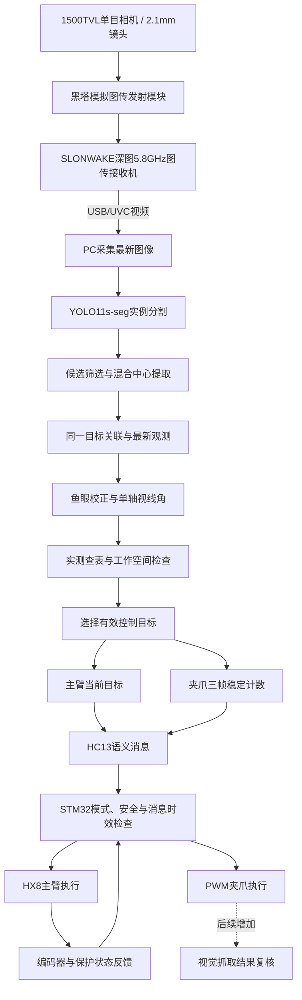
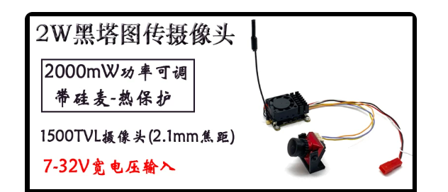
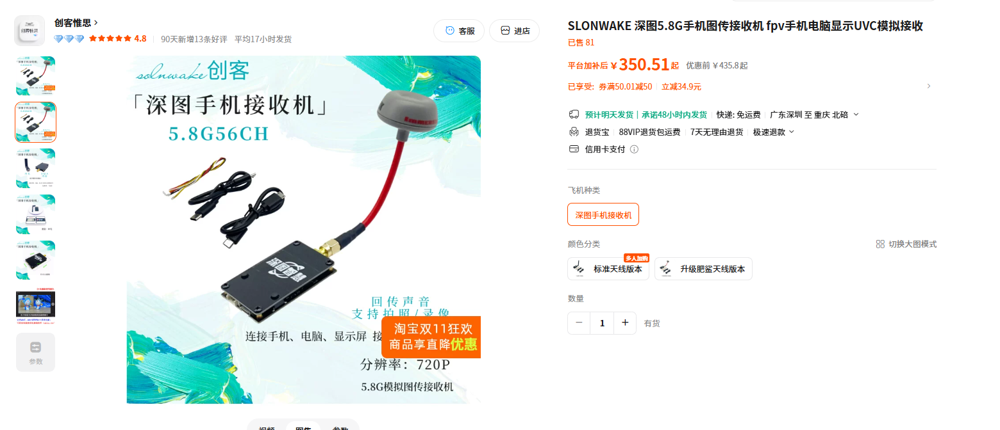

# 闭环视觉方案（规划）

## 单目实例分割、角度映射、三帧确认与机械臂反馈监督

编制日期：2026-10-22。版本：统一证据版。对象：AerialRoboArm 单轴折叠臂与泡沫目标。依据：当前本地视觉与下位机代码、模型元数据、用户确认的图传硬件、历史通信记录及可追溯的离线 GPU 计时。

## 阅读结论与数据使用规则

本方案完整覆盖硬件、模型、几何、跟踪、三帧确认、消息、执行、反馈和验证。已有图像识别与主臂反馈监督链路，完整图像误差闭环和抓取结果自动判断需要按第14节继续实现。当前常用构建缓存的三帧开关为OFF，尚不能据此认定板上已部署自动三帧闭爪。

目前能够直接报告的当前权重离线PC处理链路为：200次样本，中位数8.59ms、P95为10.53ms。相机到USB图像、无线单向传输、执行器机械响应和抓取成功延迟尚无完整、同步的实测。因此，**不能确信每一个物理环节的真实延迟，也没有可信的整机总延迟数字**。

| 数据类型 | 可以怎样使用 | 不可以怎样使用 |
| --- | --- | --- |
| 可追溯的本机离线测量 | 写明权重、环境、样本、测量边界和统计口径后引用 | 当作在线相机到机械动作的端到端结果 |
| 历史记录 | 按原始测试方式和条件引用，注明本轮未复测 | 宣称为当前系统单向延迟或P95 |
| 源码与构建配置 | 确认周期、门限、接口和构建状态 | 将配置周期等同于真实执行耗时 |
| 商品页标称参数 | 说明选型规格及来源 | 当作已实测功耗、帧率、精度或延迟 |
| 条件推导 | 给出假设和公式，帮助设计试验 | 与实测混合相加后宣称整机性能 |
| 尚未测量 | 保留为未知并给出测法 | 用经验数字、0ms或宣传值填补 |

## 1. 方案结论与能力边界

采用“单目模拟相机与图传采集、地面 PC 实例分割、鱼眼视线角换算、机构实测查表、无线语义传输、STM32 仲裁与执行”的总体方案。主臂及时跟随有效视觉目标；夹爪使用独立的连续三帧稳定确认，在主控准入条件满足后闭合。

本方案服务于受控、单轴、特定目标的抓取验证。PC 使用当前观测位置，未启用未来 0.4 s 位置外推。

“闭环”分为三个层次，必须分别说明：

1. **已有执行器位置闭环**：HX8 内部编码器与控制器跟踪角度指令，STM32 回读角度及保护状态，进行外部监督。
2. **已有持续视觉引导**：相机持续观察目标，PC 不断更新对应目标角度。当前主要依据目标位置及离线标定生成指令，没有在线同时测量目标中心与夹爪中心并迭代图像误差。
3. **后续抓取结果闭环**：闭爪后用经过验证的视觉证据判断物体是否被夹持，失败时进入明确的退出或人工处理状态。这部分尚未完成自动判定。

因此，现阶段宜称“单目视觉引导、主臂位置反馈监督与三帧确认抓取”。保留“闭环视觉方案（规划）”为标题时，应将第 3 层明确标注为规划内容，不声明已实现完整视觉伺服或抓取成功自动反馈。

本次仅形成设计与测试材料，没有修改视觉程序、下位机固件或板上程序，也没有连接串口或驱动执行器。

## 2. 系统目标与适用条件

### 2.1 功能目标

- 在实际图传画面中识别已训练的泡沫目标类别。
- 提取可见轮廓的二维中心，换算为单轴机构可消费的目标角度。
- 主臂采用有效新目标进行持续跟随，不因夹爪等待三帧而额外延迟跟随。
- 同一目标连续三次有效观测的角度极差满足条件后，产生闭爪准入信息。
- STM32 结合 AUTO 模式、遥控监督、反馈健康和急停状态决定动作。
- 记录识别、角度、稳定计数、实际指令和反馈，以便复现实验与分析失败。

### 2.2 成立条件

相机、焦距、对焦状态、分辨率及机械安装关系应与标定一致。目标应位于机构运动平面附近，并处于实测可达、可抓取的工作空间。单目视线方向本身不能唯一确定物体深度；相同射线上的不同距离目标可能给出相近角度，因此必须通过受控目标运动平面、安装几何及实抓试验限定适用范围。

三帧稳定不证明目标在夹爪包络内，也不证明主臂已到位或物体已被夹住。旧页面“适合 60 cm 内检测”等距离承诺缺乏本方案独立验收依据，应删除或补充相应实验。

## 3. 总体结构与信息流



图中 PC 只发紧凑语义，不通过 HC13 发送图像或完整掩膜。主臂反馈闭环与规划中的视觉抓取结果反馈分别表示，不能将一次 ACK 或稳定帧数当作抓取成功。

## 4. 硬件选型及原因

| 硬件/位置 | 当前型号或方案 | 选择原因 | 需明确的限制 |
| --- | --- | --- | --- |
| 机载图像采集 | “2W黑塔图传摄像头”套件中的 1500TVL 单目模拟摄像头，配 2.1 mm 镜头 | 与当前相机标定和图传链路一致；单相机便于布置和固定 | 1500TVL 是商品页分辨能力标称，不是独立像素分辨率；当前PC采集/标定使用640×480 |
| 机载图像发射 | 黑塔模拟图传发射模块，商品页标称最大 2000mW、功率可调，套件标称7–32V输入 | 与摄像头配套，将图像无线传回地面；可调发射功率便于按链路需求配置 | 2W为标称射频发射功率，不是实际设置或整机耗电功率；发射端具体频点、供电接法和硬件版本需按实物记录 |
| 地面图传接收与USB采集 | **SLONWAKE（深图）5.8G 56CH 手机/电脑 UVC 模拟图传接收机，直接接电脑USB接口** | 同一设备完成图传接收与USB视频输出，PC可作为视频源读取，减少外置独立采集设备与连接 | 接收机商品页标称720P不等于当前程序使用720P，也不能证明相机产生720P有效细节；USB/UVC兼容性不等于已验证低延迟 |
| 地面视觉计算 | 现有 PC，RTX 4070 Laptop GPU，约 8 GB 显存 | 已有 CUDA/PyTorch 环境；运行专用分割模型；不增加机载 GPU 的质量、供电与散热负担 | 不能将地面 PC 功耗忽略后宣称整个系统低功耗；无线链路仍是依赖 |
| 视觉语义链路 | PC 端与 MCU 端各一块 HC13，230400 baud、8N1 | 目标消息短、现有链路已打通；图像回传与控制消息分离 | 串口波特率不等于无线链路吞吐；模块为半双工，双向高频消息可能影响时延 |
| 机载控制 | STM32F103C8T6 自制控制板 | 消费角度与状态语义，完成模式、安全及动作协调；避免在 MCU 上部署神经网络 | 控制任务配置 20 ms，不等于已证明最坏响应不超过 20 ms |
| 主臂执行 | HX8-U26H-M 总线舵机 | 集成无刷电机、驱动、12 位绝对值磁编码器和内部位置闭环，可回读状态 | 编码器 0.088°/计数是标称分辨率，不是整机绝对角度精度；机构间隙、负载和标定仍影响结果 |
| 舵机总线转换 | UC-01 | 当前主臂链路实际需要的全双工/半双工转接及供电接口 | 作为系统功能件保留；不把板载 Type-C 配置功能列成额外运行设备 |
| 夹爪执行 | PTK 7462W PWM 舵机，PA0/TIM2_CH1 | 已有开合机构与 PWM 驱动；指令简单 | 没有向 MCU 提供夹持或角度回读；型号 7462W MG 的供应商参数需以实物复核 |
| 人工监督 | RadioMaster Pocket ELRS 与 ELRS-2.4G-NANO 接收机 | 手动操作、模式选择与接管；与视觉语义链路分工 | 自动动作仍需遥控与安全准入，不属于脱离人工监督的全自主系统 |

选型原则为轻量、紧凑、机载供电负担可承受及适度配置。质量和功耗优势以实际整机清单测量后量化，本方案不杜撰相机、发射模块和UVC接收机的重量或功耗。

HX8 官方规格见 <https://fashionstar.com.hk/wiki/uart-servo/hx8-u26h-m/>；其他当前板级选型依据 `../hardware/pinmap.md`。前三项已按用户提供的商品截图补充选型名称，仍需实物标签补齐确切型号、版本及运行设置。

### 4.1 图传接收机与电脑的实际连接

机载侧由摄像头取得画面，经黑塔发射模块无线传回；地面侧由深图接收机接收，并通过其USB/UVC接口直接将视频交给电脑。按用户确认的连接方式，当前**没有必要额外列一块独立“USB视频采集卡”**，原先“低缓冲采集卡接入PC”的文字改为“USB/UVC图传接收机直接接入PC”。

图像链路与角度消息链路分开：前者进入PC的视频源，后者由PC经HC13发送给STM32。图传接收机负责视频接收与采集，不执行YOLO识别；模型仍在PC上运行。接收端标称5.8GHz/56CH，发射端必须匹配兼容的频段、频点和视频制式，不能只凭两个设备都有天线就认定配置正确。

这些参数来自用户于2026-10-22提供的选型截图，不是本次独立硬件检测或功耗测试。截图用于型号与接口追溯，不将商家价格或宣传性描述作为技术性能证据。





## 5. 模型原理、训练与选型依据

### 5.1 当前模型

实时权重为 `foam_center_v9_gripper_axis_normal_bg03_20260816_candidate.pt`，架构为 **YOLO11s-seg**，类别为 `foam_board`。V9 是项目版本，不是 YOLOv9。权重 SHA-256 为 `04595f4f5d92afc5ec219d1a7a3e20d2b1a8a6ad7d01230813a954d019b7a8c3`。

### 5.2 网络处理过程

图像经比例缩放/补边、BGR→RGB、通道排列转换及浮点归一化后送入网络。`imgsz=640` 是推理尺寸配置，不等于强制将 640×480 图像拉伸成正方形。像素归一化可表示为：

$$I_n(u,v,c)=I(u,v,c)/255.$$

Backbone 通过卷积与特征组织提取局部边缘、纹理和较高层语义；YOLO11 配置包含 Conv、C3k2、SPPF 与 C2PSA。Neck 通过上采样、拼接与下采样融合不同分辨率特征，在 P3/P4/P5 尺度输出；Head 生成位置、类别分数与掩膜信息。

分割头提供掩膜原型 $P_j$ 和每个实例的组合系数 $c_{ij}$，可概括为：

$$\hat M_i=\sigma\left(\sum_j c_{ij}P_j\right).$$

实际框架还包括裁剪、尺寸恢复和二值化。输出包含目标框、类别、置信度与可见区域掩膜。

后处理使用候选分数筛选和 NMS，交并比为：

$$IoU(A,B)=\frac{|A\cap B|}{|A\cup B|}.$$

当前入口识别候选置信度门限为 0.50、NMS IoU 参数为 0.50；控制目标门限另设为 0.60。置信度数值不是实际准确率或抓取成功概率。

### 5.3 训练原则与记录

当前候选模型元数据记录训练图 1079 张、验证图 155 张；从已有分割权重继续训练，Batch=8、imgsz=640、AdamW、初始学习率 0.0002、计划 25 轮并使用早停。场景覆盖与负样本质量需要持续完善，不能将同一录像相邻帧跨集合分配来制造高指标。

概念损失为：

$$L=\lambda_cL_{cls}+\lambda_bL_{box}+\lambda_dL_{DFL}+\lambda_mL_{mask}.$$

训练通过反向传播更新参数，使类别、定位与掩膜预测接近标签。标签的中心定义必须与实际要控制的目标点一致：可见区域质心不是被遮挡物体的完整三维几何中心。

### 5.4 为什么采用 s-seg

分割可提供中心提取所需轮廓；s 规模是当前已集成的计算开销与定位能力折中。现有硬件并没有迫使系统只能使用 s，当前也没有同条件证据证明 s 优于 m/l 或新一代分割模型。采用现有基线的依据是可复现训练、已有接口与标定集成；“最优”须由对比试验确认。

官方结构与原理资料：

- <https://docs.ultralytics.com/models/yolo11/>
- <https://raw.githubusercontent.com/ultralytics/ultralytics/v8.3.218/ultralytics/cfg/models/11/yolo11-seg.yaml>
- <https://raw.githubusercontent.com/ultralytics/ultralytics/v8.3.218/ultralytics/nn/modules/head.py>
- <https://raw.githubusercontent.com/ultralytics/ultralytics/v8.3.218/ultralytics/utils/loss.py>

这些资料用于解释网络原理；本次计时实际环境为 Ultralytics 8.4.33，不能把上述版本号当作本次环境版本。

## 6. 图像中心、跟踪和单轴几何

### 6.1 混合中心

定义检测框面积占比：

$$\rho=\frac{(x_2-x_1)(y_2-y_1)}{WH}.$$

当 $0.01\le\rho\le0.13$ 且掩膜轮廓有效时，代码使用轮廓图像矩：

$$u_c=m_{10}/m_{00},\qquad v_c=m_{01}/m_{00}.$$

极小、近距离超大或轮廓退化时退回框中心：

$$u_c=(x_1+x_2)/2,\qquad v_c=(y_1+y_2)/2.$$

1% 与 13% 指检测框占画面面积，不是掩膜面积。混合策略旨在兼顾正常尺寸下的轮廓定位与异常尺寸下的鲁棒性，不能保证所有遮挡条件都准确。

### 6.2 目标关联

跟踪状态为 $\mathbf x=[u,v,\dot u,\dot v]^T$，按匀速模型预测：

$$\mathbf x^-_k=F(\Delta t)\mathbf x_{k-1},\quad F=\begin{bmatrix}1&0&\Delta t&0\\0&1&0&\Delta t\\0&0&1&0\\0&0&0&1\end{bmatrix}.$$

新检测经位置距离与类别一致性筛选，按距离从小到大贪心关联，再作 Kalman 更新。它不是 ByteTrack 或匈牙利最优匹配。拥挤或交叉目标仍可能发生身份关联错误。

当前 `current` 模式保留轨迹身份，但角度计算使用最新检测的混合中心，避免将滤波中心的滞后直接引入跟随。`coast_frames=0`，漏检轨迹可暂时保留以供重新关联，但不作为当前有效动作目标。现有未来位置预测模块不参与本方案。

### 6.3 鱼眼标定与射线

当前相机文件对应 2.1 mm 镜头、640×480 图像；53 张有效标定图，记录重投影误差约 0.2286 px。此误差是标定图像误差，不能直接称作机械臂角度精度。

内参矩阵记录为：

$$K=\begin{bmatrix}419.3554&0&321.3737\\0&581.8531&240.1912\\0&0&1\end{bmatrix}.$$

鱼眼模型可用 $r=\sqrt{a^2+b^2}$、$\theta=\arctan(r)$ 及

$$\theta_d=\theta(1+k_1\theta^2+k_2\theta^4+k_3\theta^6+k_4\theta^8)$$

描述。运行中由 `cv2.fisheye.undistortPoints` 对目标点求逆映射，得到归一化射线 $\mathbf r\propto[x_n,y_n,1]^T$。程序先在采集图像上分割，再校正目标中心点，并非必然先对整幅图像去畸变后推理。

机械臂平面角和横向角分别为：

$$\alpha=\operatorname{atan2}(r_y,r_z),\qquad \psi=\operatorname{atan2}(r_x,r_z).$$

$\alpha$ 向画面下方为正；$\psi$ 用于检查目标是否接近机构中轴平面，当前容差为 $|\psi|\le5^\circ$。不能将横向角直接叠加到单轴目标角。

OpenCV 原理：<https://docs.opencv.org/4.x/db/d58/group__calib3d__fisheye.html>。

### 6.4 机构实测查表

相机视线角不是舵机角。用实测节点 $(\alpha_i,g_i)$ 建立单调映射，在相邻节点间求：

$$g=g_i+\frac{\alpha-\alpha_i}{\alpha_{i+1}-\alpha_i}(g_{i+1}-g_i).$$

当前快速启动脚本显式加载 `servo_to_optical_angle_foam_center_lut_20261008_combined_v1.json`，其范围为 $[-77^\circ,-32^\circ]$，与机构软件范围 $[-90^\circ,+85^\circ]$ 相交后仍为前者。普通 `run_realtime.py` 默认保留旧的 8 月标定表，二者不可混述。

10 月 8 日表使用的节点已汇集多段标定录像，文件状态为独立验证待完成。训练残差、旧装夹精度及旧表误差不能直接当作此表的独立精度；真实抓取前需验证当前装夹。表中实测关系已经包含传动影响，运行时不能再重复乘齿轮比。

## 7. 控制目标、三帧确认与执行

### 7.1 控制目标筛选

有效目标需同时满足：本帧检出、类别正确、分数不低于 0.60、横向位置有效、完成舵机标定换算、处于标定与机构允许范围。多个候选同时有效时，当前选择最高置信度目标，不是最近目标。

### 7.2 两条独立逻辑

主臂通道采用单次有效观测，及时发送当前目标。夹爪通道维护同一 track 的最近三个有效角度：

$$\mathcal G_k=\{g_{k-2},g_{k-1},g_k\},\qquad S_k=\max\mathcal G_k-\min\mathcal G_k.$$

当前稳定条件为窗口满三帧且 $S_k\le2^\circ$。例如 $[-59.8,-59.3,-59.5]^\circ$ 的极差为 $0.5^\circ$，满足条件。

无有效目标或切换 track 时清空窗口；满三帧但极差过大时，PC 对外稳定值为 0，窗口继续滑动，不应笼统写成内部历史立即全部删除。三帧用于触发确认，不代替主臂的当前目标，也不证明主臂到位。

### 7.3 消息

当前五字段格式：`V,<g>,<speed>,<confidence>,<stable_frames>\r\n`。示例 `V,-60,0,92,3\r\n` 为 14 字节，表示 −60°、速度选 MCU 默认、置信度分数 92、稳定帧数 3。正常心跳 20 Hz；稳定值 1→2→3 变化会及时发送，不必等待下一次 50 ms 心跳。

PC 需人工按 A 允许发送；MCU 还需处于正常 AUTO 并满足遥控、安全与主臂健康条件。ACK 仅表明消息解析，不能证明电机已到位。

当前消息没有相机源序号、源时间戳或 track ID 字段。MCU 的 `frame_id` 是接收消息本地计数，不是相机帧号，也不能独立验证消息确属三个不同采样时刻。现有 PC 跳过重复缓存并维护轨迹是重要前提；后续协议可加入源序号、目标标识和时间契约，不能直接用 PC 时间减 MCU 时间。

### 7.4 下位机准入

启用三帧闭合构建时，进入 AUTO 先张开到 130°；主控消费新的有效消息，满足自身计数和 PC 稳定值条件后，发出 90°闭合指令。闭合后保持，主臂仍继续跟随。

主控检查 AUTO、RC 在线、急停、锁存故障、视觉时效、舵机反馈年龄、电压和保护位等。视觉仲裁默认新鲜窗口 200 ms；主臂/闭爪反馈年龄门限为 140 ms。控制任务重读同一缓存消息不会增加确认次数，AUTO 入口已有缓存不直接算作本轮新观察。

当前代码中 `AUTO_GRIP_THREE_FRAME` 默认为 OFF。本轮还核对到常用目录 `cmake-build-debug/CMakeCache.txt` 中该值为OFF，ON才执行上述自动闭合，OFF时为CH4手动夹爪。缓存状态不能独立证明当前板上程序，但足以说明本目录不能直接当作已经启用三帧闭爪的构建。三帧方案演示必须使用经确认的ON构建，并记录固件哈希，本文没有切换开关或烧录。

### 7.5 位置反馈与闭环扩展

主臂角度误差为 $e_g=g_{ref}-g_{fb}$。HX8 内部完成位置伺服，MCU 以反馈进行状态及故障监督，现有有限位置微调不是重新实现高频 FOC。

若扩展严格的图像误差反馈，需在线可靠测量目标与夹爪在同一图像坐标中的位置，定义 $e_v=v_{target}-v_{gripper}$，再根据标定或局部雅可比更新主臂目标。该式说明规划方向，当前代码没有自动实现这条完整图像误差迭代链。

抓取结果反馈的规划为：闭爪后观察目标是否在预定时间内与夹爪保持相对关系，并通过独立标注录像验证判据。不能只以目标消失或框重叠判为成功，因为遮挡和漏检也会产生相同现象。验证前由录像和人工实物检查标记成功/失败。

## 8. 延迟定义与本次实测

### 8.1 分开定义时间终点

- $T_{detect}$：解码图像进入 PC 处理，到产生检测/分割结果。
- $T_{PC}$：解码图像进入处理，到完成中心、跟踪、角度和门控。
- $T_{command}$：物理目标变化或首次有效观测，到主控发出对应动作命令；起点必须写明。
- $T_{close}$：物理目标变化或首次有效观测，到夹爪完成指定闭合动作。
- $T_{grasp}$：到经过独立判据确认抓取成功。

模型推理、指令发送、实际闭合及抓取成功是不同指标。本次没有开展整机端到端物理计时。

### 8.2 新增离线 GPU 计时方法

2026-10-22 使用快速入口指定的 Python 环境和当前 V9 权重，在本机离线执行，不连接相机或串口，不发送执行器命令。

- GPU：NVIDIA GeForce RTX 4070 Laptop GPU，显存约 8 GB。
- Python 3.12.9；PyTorch 2.6.0+cu118；Ultralytics 8.4.33；OpenCV 4.13.0。
- batch=1、FP32、imgsz=640、conf=0.50、IoU=0.50。
- 从本地 155 张验证图中均匀抽取 100 张已解码 640×480 图像，预热 10 张，执行两遍，共 200 次计时。
- 用 CUDA 同步界定模型调用和处理终点，避免仅测到异步排队时间。
- PC 路径包含模型调用、轮廓中心、目标关联、相机换算、查表、有效目标与门控，以及可用时的消息编码。
- 不含图片文件读取、曝光、图传、采集排队、GUI显示、实际串口、无线、MCU与机械运动。独立图片的顺序不代表真实连续目标运动，结果只用于耗时，不用于跟踪或抓取效果评估。

| 时间项 | 中位数 ms | P95 ms | 数据性质 |
| --- | ---: | ---: | --- |
| 框架记录的预处理 | 0.66 | 0.87 | 本次离线实测 |
| 框架记录的神经网络推理 | 6.70 | 7.73 | 本次离线实测 |
| 框架记录的后处理 | 0.84 | 1.42 | 本次离线实测 |
| 完整模型调用墙钟时间 | 8.34 | 9.79 | 本次离线实测，含调用开销 |
| 模型返回后的中心、几何与门控 | 0.35 | 0.69 | 本次离线实测 |
| **PC处理链路总耗时** | **8.59** | **10.53** | 本次 200 个样本，含有目标与无目标图片 |
| 有检测结果子集的PC总耗时 | 9.44 | 11.00 | 100 次有检测样本，来自同一计时数据 |

总处理平均值 8.85 ms，最大观测值 18.09 ms。P95 不是硬实时上界；各阶段分位数不能直接相加得到总分位数。有效控制目标子集只有 20 个样本，不足以据此做普适时延保证。

原始证据：[pc_processing_benchmark.json](../../outputs/vision_plan_20261022/pc_processing_benchmark.json)。结果保留每次计时、权重哈希、设备和环境版本。本次不是模型横向排名，未测试 m/l 或新架构。

项目 `requirements.txt` 固定 8.3.218，而实际启动环境为 8.4.33；复现本表应使用记录环境，后续需统一环境锁定。早期基础权重约 4.4 ms/帧的历史记录不能覆盖本次当前权重与处理口径。

### 8.3 每个物理和软件环节的延迟证据

| 环节与测量边界 | 当前可确信的结论 | 数据性质 | 证据或待测方法 |
| --- | --- | --- | --- |
| 物理目标变化至相机完成有效曝光/读出 | 实际延迟未知 | 未测 | 同步光学事件或相机可追溯时间基准 |
| 摄像头输出至模拟发射、空中链路、接收机解调 | 实际延迟未知 | 未测 | 同一光学事件与接收端图像对照，不按传播速度忽略设备处理 |
| 接收机内部视频转换、USB/UVC及PC采集排队 | 实际延迟未知 | 未测 | 光学时间码/双画面录像及主机取帧时间联合检查 |
| 解码图像进入PC至完整模型调用返回 | 中位8.34ms，P95为9.79ms | 当前权重离线实测 | E01，200次墙钟计时，CUDA同步 |
| 模型返回至中心、跟踪、映射和门控结束 | 中位0.35ms，P95为0.69ms | 当前权重离线实测 | E01，合并区间，不再分配虚构子项时间 |
| 解码图像进入PC至处理链路结束 | 中位8.59ms，P95为10.53ms | 当前权重离线实测 | E01，逐样本总时间直接统计 |
| 三帧有效观测累计 | 实际在线时间未知；跨度按2/F_obs推导 | 条件推导 | 记录三次新有效图像的单调时间，不能用推理FPS代替 |
| PC编码完成至字节交给串口驱动 | 实际排队与系统调用延迟未知 | 未测 | PC单调时钟记录调用起止，并与串口电气事件关联 |
| 单段UART传输示例14字节视觉帧 | 约0.608ms | 参数推导 | 230400 baud、8N1，只包括串行化 |
| PC发出视觉消息至MCU接收解析 | 单向时间未知；历史回显RTT约28至31ms | 历史记录 | E02，未做跨时钟同步与本轮复测 |
| MCU解析至控制逻辑消费 | 实际分布未知；控制任务配置20ms | 代码参数 | E03，需记录接收、消费及循环超期事件 |
| 控制目标生成至FSUS发令 | 实际分布未知；最小目标间隔配置40ms | 代码参数 | E03，结合最后发令时刻、总线间隔与UART事件测量 |
| FSUS位置命令16字节UART传输 | 约1.389ms | 参数推导 | 115200 baud、8N1，不含舵机响应 |
| HX8接令至输出轴开始运动或到位 | 实际时间未知，随行程、负载和轨迹变化 | 未测 | 输出轴录像/外部测量，编码器回读作辅助 |
| 主臂反馈观测 | 查询周期配置100ms，不是内部闭环周期 | 代码参数 | E03，回读可能因发令推迟，需统计真实新反馈间隔 |
| 夹爪PWM设置至新有效脉冲 | 实际相位待测；PWM周期由配置算得3ms | 配置推导 | E03，逻辑分析或示波器观察输出 |
| 有效PWM命令至夹爪接触、闭合或稳定夹持 | 实际时间未知 | 未测 | 高速录像和预先定义的物理终点 |
| 场景变化至抓取成功 | 没有可报告的整机实测结果 | 未测 | 同一时基记录场景、发令、动作和成功判据 |

“未知”不表示系统无法工作，而表示当前缺少可追溯的测量。测量边界不同的数据不可互换。历史回显RTT、UART序列化、MCU周期和机械时间不能在未厘清包含关系时直接相加。

### 8.4 已有通信与代码参数

| 环节 | 数值 | 证据及正确含义 |
| --- | --- | --- |
| HC13 历史回显 RTT | 28–31 ms | `../hardware/hc13_config.md` 的历史工具回显记录；不是本次复测，也不是当前部署链路P95 |
| HC13 单向估算 | 约 14–16 ms | 仅在往返近似对称时粗估 RTT/2；没有独立单向同步测量 |
| 示例视觉帧 UART 发送 | 约 0.608 ms | 14 字节×10 bit/字节÷230400；仅一段串口物理序列化，不含无线与USB |
| PC 普通目标心跳 | 50 ms | 配置 20 Hz；稳定计数变化可立即发送，不能把 50 ms 当固定新增延迟 |
| MCU 控制周期 | 20 ms | 无超期、相位近似随机时等待可按0～20 ms估算，平均约10 ms；非最坏保证 |
| HX8 目标最小发送间隔 | 40 ms | 连续目标可能等待；首次或已到期命令不必再固定加40 ms；与控制相位相关 |
| FSUS 帧间隔 | 5 ms | 代码最小间隔，有剩余等待才产生额外延迟 |
| 主臂位置命令 UART | 约 1.389 ms | 16字节×10÷115200；不含舵机解析、总线等待和机械响应 |
| 主臂监控查询周期 | 100 ms | 反馈观测节拍，不是舵机内部闭环周期，发送目标时还可能推迟回读 |
| 回包等待超时配置 | 20 ms | 单次事务接收等待参数，不能当作正常固定耗时或整循环上界 |
| 夹爪 PWM 周期 | 3.000 ms | TIM2为1 MHz计数、3000计数/周期；属于配置推算 |

已包含在某个 RTT 或整体测量中的 UART、调度等部分，不能再次加到同一预算里。当前 ACK 限流、轮询和记录时刻还会影响以日志推算时延，不能直接用 ACK 到达作为电机到位终点。

### 8.5 三帧确认时间

设连续有效观测率为 $F_{obs}$，从第一帧到第三帧跨两个有效间隔：

$$T_{3span}\approx\frac{3-1}{F_{obs}}.$$

| 有效观测率 | 第一帧至第三帧跨度 |
| --- | ---: |
| 25 Hz | 80.0 ms |
| 30 Hz | 66.7 ms |
| 50 Hz | 40.0 ms |
| 60 Hz | 33.3 ms |

此处 $F_{obs}$ 是新的有效视觉观测频率，不是纯推理FPS或显示FPS。漏检、换目标、失稳、帧丢弃或传输合并都会延长确认。历史50FPS录像不证明当前实时链路始终有50Hz有效观测。MCU还需在AUTO入口后消费足够的新消息，入口清零或多个消息在同一周期内被合并观察时可能额外等待，不能把 $2/F_{obs}$ 当作整套系统确认时间。

### 8.6 整机时间模型与暂不能填入的数值

从物理场景变化到实际闭合，可按事件边界定义：

$$T_{close}=T_{image}+T_{vision}+T_{link}+T_{MCU}+T_{PWM}+T_{mechanical}.$$

其中T_image覆盖曝光、图传和UVC采集，T_vision覆盖取得有效确认所需的图像跨度和PC处理，T_link覆盖完整语义传输，T_MCU覆盖解析、消费和动作准入，T_PWM覆盖输出更新，T_mechanical以实际物理终点计。真实系统存在流水并行、丢帧及相关排队，应按同一试验的时间戳定义区间，不能把不同条件的中位数和P95拼成新的统计结果。

当前只有T_vision中的PC离线处理部分可用本次计时支撑，其余关键区间仍未完成同步测量。因此，本版不填写整机T_close或T_grasp的具体数值，早期条件预算中的约75ms发令、约130ms闭合不作为性能结论继续引用。

供应商舵机速度、配置的主臂速度/加减速和PWM周期只能作为试验设计输入。它们不能取代负载下的输出轴运动、夹爪闭合和稳定夹持测量。

现有三帧方案没有等待主臂先到位。完整闭环增强方案应增加经过验证的捕获窗口与到位准入，具体门限由机构抓取容差反推，不在本方案中杜撰一个“通用到位角度”。

## 9. 与其他方案的比较

| 对比对象 | 本方案的有依据优势 | 对方可能的优势/本方案局限 | 必须验证的内容 |
| --- | --- | --- | --- |
| 单目检测框中心 | 正常尺寸下利用分割轮廓计算中心；已有基础版本同一参考下的改善记录 | 分割增加计算，轮廓缺损仍会使中心变化；可见质心未必是最佳抓取点 | 统一参考下中心及角度误差P95 |
| 单帧直接闭爪 | 增加同一轨迹、连续有效和角度稳定约束，能够拒绝一部分瞬时异常 | 至少多两个有效观测间隔；持续误检或稳定错误目标仍可能通过 | 相同录像的误触发、漏触发与确认时间 |
| 双目深度方案 | 一个相机更便于现有安装；无需双目外参与立体匹配；现有单轴标定可复用 | 双目可提供深度与更广工作空间；本方案对工作平面和可达空间约束更强 | 同条件整机重量、功耗、精度与端到端延迟 |
| 机载GPU视觉 | 将视觉计算质量、供电和散热负担转移到地面；已有PC便于调试 | 依赖图像与命令无线链路；机载计算可避免部分无线往返并提高独立性 | 机载总质量功耗、丢链行为和可用性 |
| 更大或更新分割网络 | 当前权重、中心、查表和控制接口已集成，有记录可复现 | 新模型可能更准或更快；现有模型未证明最优 | 同数据同硬件测当前s、11m-seg及新架构同级模型 |

双目理想几何为 $Z=fB/d$，其深度误差近似 $\sigma_Z\approx Z^2\sigma_d/(fB)$。它需要基线和视差估计；不能只以“多一个摄像头”判断其效果。单目省去这部分计算，但仍需要单目标定与机构标定，也放弃了直接立体深度信息。立体原理见 <https://docs.opencv.org/4.x/dd/d53/tutorial_py_depthmap.html>。

不应在未比较前写“延迟低于双目”“优于所有数字图传”“当前模型最优”“增加三帧就不会误抓”。本方案是纯单目视觉引导，因此旧页面“相比纯视觉方案”的栏目应改成“相比单帧触发”或“相比检测框定位”。

## 10. 已有验证与正确引用

### 10.1 基础版本中心策略对比

V8框中心与保留V9基础分割/框混合中心的同一历史验证参考下，平均中心误差约5.24px降至2.69px，P95约15.91px降至10.76px。这支持中心策略选择，但不能证明当前候选在新装夹下仍保持相同误差，也不能证明s优于m/l。

### 10.2 当前候选模型记录

在置信度0.30的一组独立分割验证中，正样本76/76检出，负样本2/79误检；中心平均误差2.39px、P95为11.37px。另一段未参与训练、光照不均录像在置信度0.50下记录369/455正样本检出，即81.1%，困难负样本9/96误检，即9.4%。二者条件不同，不能混成一个准确率；后者也不能直接推算三帧误闭爪概率。

旧安装和旧表曾记录与编码器关系的验证，不能当作当前10月候选表的独立物理精度。相机重投影误差、视觉中心误差、视线角误差、舵机角误差及实际末端误差应分开报告。

### 10.3 当前未知项

相机/发射模块的精确型号与运行功率、接收机硬件版本、实时有效观测率、曝光与接收机USB采集排队、无线单向P95、实际主臂到位时间、带载夹爪闭合时间、误闭爪率及重复抓取成功率，均需补录或专门测试。用户已确认地面使用USB/UVC图传接收机直接接电脑，本文不再把独立采集卡作为现有硬件。本文不以离线GPU计时替代这些值。

## 11. 验证方案与验收门

### 11.1 统一事件与延迟测量

建议事件为场景光学变化、PC首次采集、模型结果、稳定判定、PC发送、MCU解析、MCU发令、舵机开始运动、实际闭合及抓取结果。记录帧/消息序号与目标ID，PC侧用单调时钟、MCU侧用单调计数，避免用系统墙钟作毫秒级差值。

物理端到端优先采用同一高速录像同时观察可见光学事件、执行器开始动作及闭合终点；测试用标记或测量设备仅用于试验，不列入正式系统主要硬件。240FPS相邻帧约4.17ms，两终点均存在离散采样误差，报告分辨率并明确判帧方法。

分段电气计时可用MCU事件IO、逻辑分析仪及串口波形，但PC与MCU跨时钟需建立映射和误差界。历史RTT只辅助了解链路量级，不替代此测试。

### 11.2 性能试验

对静止、慢速、较快目标，分别改变正常光/暗光/光照不均、背景、遮挡、距离与方向。每种条件独立录像；按完整录像划分训练、调参和最终测试，最终测试不得用于调阈值。

至少记录Precision/Recall、正样本漏检、困难负样本误检、中心误差及角度误差分布，PC耗时和物理端到端延迟的P50/P95/最大观测值，以及三帧触发时延、误闭爪、漏触发和抓取成功率。控制误触发以完整事件或试验轮次统计，不能把检测框误检率当作误闭爪率。

建议一轮受控可行性试验先做30次，结果以成功数/总次数及失败原因报告；要形成更有说服力的成功率估计，应扩展重复次数并覆盖工况，避免只展示成功视频。

### 11.3 建议门槛，非既有验收结果

| 阶段 | 交付与建议门槛 |
| --- | --- |
| P0 固化基线 | 记录权重哈希、环境、相机状态、标定版本与MCU构建；确定三帧配置启用 |
| P1 标定验收 | 新装夹用未参与拟合的独立录像验证；边界及换向均覆盖，误差门限由有效抓取窗口反推 |
| P2 时间测量 | 完成完整事件计时；可把PC处理P95≤15ms作为本机下一轮目标，但不当作端到端目标 |
| P3 三帧策略对比 | 相同数据与条件比较单帧/三帧的误触发和漏触发，量化新增等待 |
| P4 低速实抓 | 报告有效工作空间、实际闭合时间及成功数/总次数；确认主臂与夹爪时序匹配 |
| P5 结果反馈扩展 | 先建立并独立验证视觉成功判据，再接入自动状态机 |

端到端目标应从抓取窗口反推：若允许剩余位置误差为 $\epsilon$，目标相对速度为 $v$，则未补偿延迟的粗略约束为 $T_{allow}\lesssim\epsilon/|v|$。例如5mm窗口裕量、0.1m/s相对速度只给约50ms时间量级；它是说明需求关系的假设示例，不是本机构已测参数。三帧窗口、曝光、无线、主臂和夹爪运动应一并纳入，不因GPU很快就认定可抓快速目标。

## 12. 可用于PPT的内容组织

详细方案不应压成一页。建议4页讲解：

1. **总体方案与硬件分工**：机载相机/图传、地面PC、HC13、STM32与执行器；说明单轴受控场景和机载负担。
2. **识别与角度计算原理**：分割掩膜、混合中心、鱼眼校正、单轴视线角、实测查表，展示实际图像与中心。
3. **三帧确认与控制时序**：同一目标、≥0.60分数、极差≤2°、主臂及时跟随、夹爪独立确认；说明实际构建开关。
4. **延迟证据与方案比较**：本次PC总处理8.59ms中位数/10.53ms P95、历史HC13 RTT28–31ms、50Hz条件下三帧跨度40ms；标明整机闭合与抓取成功延迟待测。

可直接使用的介绍文字：

> 本课题采用单目实例分割与三帧稳定确认的视觉引导方案。机载1500TVL摄像头配2.1mm镜头，通过黑塔模拟图传发射模块发送图像；地面SLONWAKE深图5.8GHz图传接收机直接接入电脑USB接口，以UVC视频源提供画面。PC运行YOLO11s-seg提取泡沫目标轮廓，根据混合中心策略、鱼眼标定和机构实测关系计算主臂目标角度，再经HC13传给STM32。主臂持续跟随有效目标，夹爪在同一目标连续三次有效观测且角度极差不超过2°、主控安全条件满足时闭合。现有主臂位置反馈承担执行监督，抓取结果的自动视觉复核作为后续闭环扩展。

延迟介绍可用：

> 在本机RTX4070 Laptop GPU上，对当前权重进行了200次离线计时，PC处理链路中位耗时8.59ms、P95为10.53ms。该数据不含相机、图传、无线通信和机械运动。历史HC13回显RTT为28–31ms；若有效观测率为50Hz，第一帧到第三帧的跨度为40ms。整机从目标变化到闭爪完成的延迟仍需统一事件测试，因此不将上述分项简单合成实测整机指标。

## 13. 事实来源与复现定位

外部原理资料：Ultralytics YOLO11结构、分割头和损失实现；OpenCV鱼眼模型及立体几何；Fashion Star HX8官方规格。链接已置于相关章节。

视觉工程根目录：`D:/Study_data/AerialRoboArm-Vision-Core`。

- `start_fast_vision_control.bat`、`run_realtime.py`：当前快速启动参数、权重和默认配置。
- `vision/runtime.py`：最新帧采集、模型调用、中心、门控与输出。
- `vision/tracker.py`：关联、当前观测、相机几何及目标字段。
- `vision/servo_angle_calibration.py`：分段线性表及有效范围。
- `vision/hc13_link.py`：有效目标、稳定窗口与编码。
- `models/foam_center_v9_gripper_axis_normal_bg03_20260816_candidate.json`：候选训练与验证记录。
- `outputs/training/foam_center_v9_gripper_axis_normal_bg03_20260816/args.yaml`：训练参数。
- `docs/foam_center_v9_training.md`：保留基础模型及中心策略对比，不代替当前候选成绩。
- `configs/camera_2p1mm_640x480_fisheye.json`、`configs/servo_to_optical_angle_foam_center_lut_20261008_combined_v1.json`：几何参数、候选表与状态。

下位机依据为当前仓库 `User/task/Src/task_vision.c`、`task_arbiter.c`、`task_manipulator.c`、`task_motion.c`；`User/global/Inc/ara_prio.h`；`User/drv/Src/drv_fsus.c`；`User/bsp/Src/bsp_uart.c`、`bsp_pwm.c`；`Core/Src/tim.c`；以及 `../hardware/pinmap.md`、`../hardware/hc13_config.md`、`../hardware/AUTO_PICK_SEQUENCE.md`。历史HC13说明中的五帧文字与旧默认范围已被实时代码和快速启动参数取代，本方案采用代码中的主臂单帧与夹爪三帧分工。

本次计时原始JSON保存于本仓库 `outputs/vision_plan_20261022/pc_processing_benchmark.json`；测量脚本位于私有工作目录，不依赖相机、串口或硬件动作。仅离线测量，不代表真机已完成本方案验收。

## 14. 完整视觉闭环的增强设计

### 14.1 当前能力与需要补充的功能

| 功能 | 当前证据状态 | 完整闭环需要补充 |
| --- | --- | --- |
| 泡沫识别与分割 | 已有专用权重、实时入口和离线验证 | 扩充困难场景并冻结独立测试集 |
| 同一目标关联 | 已有位置关联和轨迹ID | 验证多目标交叉和遮挡下身份切换 |
| 图像到主臂角度 | 已有相机与查表实现 | 当前新装夹候选表完成独立验收 |
| 主臂反馈监督 | 已有角度和保护回读 | 将实际反馈关联到命令序号，统计跟踪误差和时效 |
| 三帧自动闭爪 | 已有可选代码，当前常用缓存为OFF | 确认ON构建和板上版本后做受控实抓 |
| 目标与夹爪相对误差反馈 | 当前无完整在线实现 | 增加可靠的夹爪参考点观测或明确标注的估计方式 |
| 主臂到位及捕获窗口 | 当前三帧逻辑不额外等待到位 | 依据机构容差和相对速度加入动作时序准入 |
| 抓取成功自动确认 | 当前无独立反馈判据 | 建立并验证视觉结果判据，接入成功与失败状态 |

### 14.2 相对图像误差与修正

完整图像误差闭环需要在同一帧中得到目标参考点和夹爪参考点。夹爪参考点可通过经过训练的关键点、几何特征或可见标志定位，选择后必须覆盖遮挡和动作状态并独立评估。该增强不要求增设深度传感器，但需要新增视觉算法与标定验证。

定义主运动方向上的图像误差：

$$e_v=v_{target}-v_{gripper}.$$

若工作区局部关系可线性化，令J_v表示夹爪像素位置对主臂角度的局部变化率，修正可写为：

$$\Delta g=\lambda e_v/J_v.$$

控制方向、增益、限幅、死区和更新频率必须通过标定确定；J_v很小、符号不确定或参考点不可见时禁止使用该修正。该式只是规划控制律，当前代码未实现，不可在论文中写成已经完成的在线视觉伺服。

若只用编码器和查表预测夹爪图像位置，应明确称“基于模型的夹爪位置估计”。这种估计不能独立发现机构打滑、安装变化或标定失配，不能直接替代真实图像观测。

### 14.3 捕获窗口和闭爪准入

现有三帧稳定条件只反映角度序列的稳定。增强方案闭爪前还应检查：目标在有效工作区、夹爪参考有效、当前相对误差处于经验证的捕获窗口、主臂反馈新鲜、预估动作期间目标不会离开窗口，并且不存在人工覆盖或故障。

窗口大小应来自夹爪有效开口、目标尺寸、位置不确定性和实际闭合时间。单目没有深度测量，深度方向可达性应由实验夹具或受控运动平面保证；无法保证时不能扩大自动抓取声明。

### 14.4 结果确认和退出

闭爪后记录目标与夹爪的相对关系是否在经过验证的时间内保持，并与独立录像中的实物留存结果核对。目标消失、遮挡、框重叠或中心暂时不变都不足以单独证明成功。

若夹持后允许小幅验证动作，必须预先验证其机械条件，确认不会使目标掉落或碰撞，且由操作模式明确授权。若缺少安全的自动验证动作，结果先由人工实物检查标注，不自动生成成功信号。

失败、验证超时或参考失效时，停止新增自动目标并进入明确等待状态，由人工确认后重新开始。释放目标、重新张开或回零均是独立动作，不能作为失效后的默认隐含动作。

### 14.5 规划状态机

```text
初始化及启动检查
  -> 人工选择AUTO并允许视觉发送
  -> 等待有效目标
  -> 主臂跟随和窗口检查
  -> 同一目标三帧稳定确认
  -> 主控准入及闭爪
  -> 抓取结果验证
  -> 成功保持 或 失败等待人工处理
```

安全异常和人工接管可在各阶段打断自动流程。目标丢失、失稳或轨迹切换应撤销尚未完成的闭爪准入；已经闭爪后的异常不自动反复开合。当前功能对应至“三帧可选闭爪”部分，窗口检查及抓取结果验证为新增规划。

### 14.6 消息与反馈接口规划

现有消息V包没有图像源序号和目标ID。建议兼容旧协议，另设明确版本的新包，至少增加源帧序号、目标ID、命令序号、字段范围检查和校验。MCU拒绝重复/倒序数据，并在目标切换时重置确认。新包尚未实现，不能假设当前五字段消息已经具备这些能力。

MCU反馈可规划包含已接受命令序号、模式、实际主臂角度、反馈年龄、保护状态及夹爪命令状态。夹爪状态字段只能表述“命令已发出/待视觉确认”，没有传感依据时不能反馈“实际夹持成功”。

HC13是半双工链路，增加反馈后需要重新测试时延和丢包。接收ACK与执行反馈应分开，ACK不确认到位。跨PC和MCU的时间戳只有在建立时钟映射及误差界后才能计算单向时间，单纯增加时间戳字段不能解决同步问题。

## 15. 数据来源与复现清单

| 编号 | 证据 | 允许支撑的结论 |
| --- | --- | --- |
| E01 | 当前权重离线PC计时JSON和200条样本 | 指定环境与边界内的处理时间分布 |
| E02 | HC13配置与历史回显记录 | 历史工具回显RTT量级，本轮未复测 |
| E03 | MCU定时、任务、FSUS和PWM源码 | 周期、间隔、超时和UART字节数等配置 |
| E04 | 用户相机/发射模块和UVC接收机截图 | 用户选型名称与商品页标称规格 |
| E05 | 当前模型说明与权重元数据 | 模型架构、类别、数据与特定条件验证记录 |
| E06 | 相机JSON及10月候选机构标定JSON | 已保存标定参数、范围和待验收状态 |
| E07 | CMake选项及常用构建缓存 | 当前代码默认与本地缓存三帧开关为OFF |
| E08 | 实时入口、处理、跟踪与消息代码 | 当前实际处理顺序、门限、目标选择和稳定窗口 |

证据包附带本轮审阅时的来源路径、文件大小与SHA-256。E01在计时时记录了模型哈希和环境，其他源文件哈希是本轮审阅时的快照，不能倒推为早前计时瞬间的代码哈希。本轮没有重新测量物理图像链路或机械动作。

PDF中的“实测”仅用于E01所覆盖的离线边界，其他值按历史、配置、标称、推导或未知标注。任何未来新增数据应记录时间、硬件、固件、参数、场景、样本数和原始事件，再替换相应未知项。
