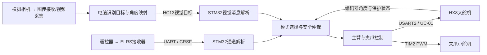

# AerialRoboArm：单轴机载机械臂控制

STM32F103C8T6 负责机械臂目标生成、安全仲裁和执行监督；HX8-U26H-M 总线舵机驱动主臂，SERVO1 PWM 舵机驱动夹爪。图像识别与角度映射在电脑端完成，主臂位置闭环由 HX8 内部实现。

[English](README.md) · [文档导航](Doc/README.md) · [程序架构与模式](Doc/design/CURRENT_SYSTEM.md) · [实际接线](Doc/hardware/pinmap.md)

## 正式控制链路



- **MANUAL**：CH1偏转累积主臂目标，回中保持；CH4控制夹爪；SE请求归零，SB请求故障复位，SD急停，SA选择模式。
- **AUTO**：持续采用有效视觉目标；目标无效或过期时进入保持逻辑。进入AUTO先输出130°开爪，之后由CH4操作夹爪。三帧自动闭爪默认关闭。
- **安全**：急停、遥控失联、堵转、设备离线和故障锁定优先于正常请求。主臂目标范围−90°～+85°。
- **执行**：HX8串口控制和反馈监督；夹爪PWM没有实际角度/夹持反馈。不是MCU高频FOC或图像误差视觉伺服。

## 无线调试与采集是另一种构建

| 项目 | 正式控制（默认） | HC13 V2调试/采集 |
| --- | --- | --- |
| 控制来源 | ELRS＋电脑视觉 | 电脑上位机，跳过ELRS |
| USART1 PB6/PB7 | ELRS，420000 | JY61P，115200 |
| USART2 PA2/PA3 | HX8/UC-01，115200 | 相同 |
| USART3 PB10/PB11 | HC13视觉目标，230400 | HC13 V2命令/遥测，230400 |
| 调度 | FreeRTOS，主任务20ms | 专用采集主循环 |
| 目标示例 | `V,-30,100,90`：−30°视觉目标 | `MOVE,101,-30000,100`：−30°手动位置命令 |
| 视觉V语义 | 度；持续跟随 | 毫度；候选＋显式触发 |

两者不能混用协议。V2上位机需搭配`HC13_HOST_LINK=ON`固件；JY61P与ELRS共用接口，不能同时接入。正式AUTO不等于V2的PREP/PICK/TRIGGER实验流程。

当前HC13实验构建的软件角度范围为−90°～+180°（PC工作位暂调至+90°、折叠预设暂调至+160°，均需实物复测），正式控制构建仍为−90°～+85°。PC手动／视觉单次抓取现使用MCU的PICK，在HX8新鲜位置反馈跨过目标前4°时应用一次闭爪PWM；普通MOVE不闭爪。高速运动的短暂反馈缺帧宽限设为400 ms，持续异常仍中止。详见[HC13 V2协议](Doc/hardware/HC13_HOST_PROTOCOL_V2.md)。

## 构建

安装 CMake 4+、Ninja、Arm GNU Toolchain，并将工具加入 PATH。使用新的构建目录，避免沿用其他模式的缓存。

```powershell
# 正式控制
cmake -S . -B cmake-build-formal -G Ninja -DCMAKE_BUILD_TYPE=Debug
cmake --build cmake-build-formal --parallel

# 无线V2：脚本明确配置编译选项，只编译不烧录
.\tools\build_hc13_host.ps1
.\tools\test_hc13_host.ps1
```

输出名保留`FOC_DEMO2.elf/.hex/.bin`以兼容CubeMX、IDE和现有脚本，并不代表仍使用BLDC/FOC。正式构建和V2构建的产物位于不同目录。

## 下载、日志和记录

DAPLink/CMSIS-DAP通过SWD下载；OpenOCD配置为`daplink.cfg`。SEGGER RTT库由DAPLink/OpenOCD读取，仍为现用依赖。`tools/flash_and_rtt.bat`是**正式debug构建**的烧录助手，不是V2一键烧录入口；执行烧录脚本前核对其固件路径。

RTT0通常经9090提供状态/控制台，采集构建使用`daplink_rtt_capture.cfg`另开9091供原始记录。V2的机构控制走HC13，RTT不接受旧`g`角度指令。

JY61P目标采样200Hz；V2无线加速度显示约20Hz。完整记录由电脑采集脚本保存到本地`outputs/`，不在本仓库跟踪范围；收到ACC或DONE不等于原始文件保存完整。

## 入口文件与当前限制

| 内容 | 源码入口 |
| --- | --- |
| 构建选择 | `CMakeLists.txt`、`Core/Src/main.c` |
| 正式控制 | `User/app/Src/app_control.c`、`User/task/` |
| 视觉目标协议（正式） | `User/drv/Src/drv_hc13.c` |
| 无线V2协议 | `User/mod/Src/mod_hc13_host.c` |
| 无线/IMU采集主循环 | `User/app/Src/app_hx8_jy60_capture.c` |
| V2角度及等待参数 | `User/app/Inc/app_hc13_host_config.h` |

V2的开闭爪等待时间、后折位置尚未标定，继续发布NA并阻止依赖这些值的自动流程；独立MOVE/GRIP与联动抓取分开。已保留构建和软件测试、历史双向查询证据，不能由此推断所有机构动作或抓取成功均已验证。电脑视觉/上位机源码不在此MCU仓库内。

历史方案已从当前文档入口移除，原始实验数据、研究照片和Git提交历史保留。本项目由[LaneTang/AerialRoboArm](https://github.com/LaneTang/AerialRoboArm)演进而来，源文件作者和第三方许可证声明继续保留。
